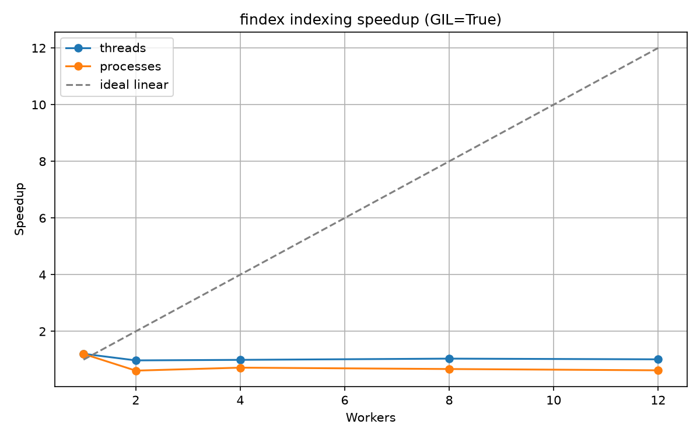

**Live demo:** https://findex-3czj.onrender.com

# Результати аналізу корпусу

## Порівняння продуктивності

| Версія алгоритму | Пікове навантаження пам'яті (MB) | Час виконання (с) |
| :--- | :--- | :--- |
| **Лінивий** | 6.46 | 2.04 |
| **Жадібний** | 14.53 | 2.21 |

## Загальна статистика

| Метрика | Значення |
| :--- | :--- |
| Оброблено документів | 1001 |
| Загальна кількість токенів | 773,247 |
| Унікальних слів | 58,234 |

## Топ-50 найчастіших термів

| Ранг | Термін | Частота |
| :--- | :--- | :--- |
| 1 | the | 49,598 |
| 2 | of | 26,975 |
| 3 | in | 21,812 |
| 4 | and | 21,603 |
| 5 | a | 14,424 |
| 6 | to | 14,380 |
| 7 | was | 7,980 |
| 8 | on | 6,528 |
| 9 | for | 6,183 |
| 10 | as | 5,818 |
| 11 | is | 5,788 |
| 12 | by | 5,091 |
| 13 | with | 5,048 |
| 14 | that | 4,261 |
| 15 | from | 4,167 |
| 16 | he | 3,979 |
| 17 | at | 3,853 |
| 18 | his | 3,043 |
| 19 | it | 3,033 |
| 20 | an | 2,731 |
| 21 | were | 2,096 |
| 22 | are | 1,944 |
| 23 | also | 1,919 |
| 24 | which | 1,883 |
| 25 | this | 1,810 |
| 26 | be | 1,809 |
| 27 | or | 1,753 |
| 28 | after | 1,665 |
| 29 | new | 1,611 |
| 30 | first | 1,591 |
| 31 | has | 1,537 |
| 32 | had | 1,527 |
| 33 | who | 1,399 |
| 34 | she | 1,395 |
| 35 | their | 1,376 |
| 36 | state | 1,333 |
| 37 | her | 1,297 |
| 38 | its | 1,294 |
| 39 | one | 1,242 |
| 40 | not | 1,240 |
| 41 | school | 1,219 |
| 42 | but | 1,156 |
| 43 | they | 1,131 |
| 44 | have | 1,105 |
| 45 | american | 1,077 |
| 46 | two | 1,050 |
| 47 | university | 1,034 |
| 48 | been | 1,027 |
| 49 | united | 955 |
| 50 | references | 953 |

## Висновки щодо використання пам'яті

На диску документи займають 6.72 MB. Різниця в 8 мегабайт між лінивим та жадібним методом якраз і містить сам так а також додатковий оверхед об'єктів списку та рядків у пам'яті python. Інші 6.46 MB займає Counter, та сама програма, якщо наприклад відключити counter то пікове навантаження буде складати 2.07 MB.

## Merge vs Set

| Терміни | Частотність | Час (Merge) | Час (Set) | Переможець |
| :--- | :--- | :--- | :--- | :--- |
| the AND of | Найчастіші (990 док.) | 0.001954 с | 0.000118 с | set |
| murderous AND manning's | Найрідкісніші (1 док.) | 0.000039 с | 0.000046 с | merge |

Set у Python реалізований на C і використовує хеш таблиці. На великих масивах даних швидкість хешування перекриває час, необхідний на виділення пам'яті під ці множини.Але на рідкрих термінах алгоритм merge працює швидше, тому що не витрачає час на створення нових структур даних у пам'яті, а просто проходить по існуючих відсортованих списках за час.

## Бенчмарк використання пам'яті

| Спосіб зберігання постінгів | Пікова пам'ять | Час індексації |
| :--- | :--- | :--- |
| @dataclass | 104.00 MB | 3.10 с |
| @dataclass(slots=True) | 99.13 MB | 3.10 с |
| array('I') | 30.79 MB | 2.13 с |

@dataclass за замовчуванням створює власний словник для зберігання своїх атрибутів. Це займає додаткових 5 MB в порівнянні з @dataclass з slots=True де цей параметр забороняє створення словників і зберігає дані в фіксованому масиві пам'яті. Модуль array натомість взагалі не створює об'єкти python, а doc_id та frequency зберігаються просто як сирі 4 байтові числа, що зменшило споживання пам'яті ще на 68 MB.

## Сериалізація

Pickle важить 6.5 MB, час завантаження 2.05 с.
JSON важить 10.9 MB, час завантаження 7.98 с.

## Перевірки BM25 (k1=1.5, b=0.75)

Корпус: 1001 документ, 58,234 унікальних термів, середня довжина документа: 772.47 токенів.

1. **Рідкісний термін вище частого** (один документ, `tf=1`):
   - `murderous` (`df=1`): **8.6881**
   - `the` (`df=998`): **0.0047**
2. **Насичення частоти (TF)** для `university` (`df=247`):
   - `tf=1`: **1.8678**
   - `tf=19`: **3.3425**
   - `tf=20`: **3.3499** (приріст `+0.007347`)
3. **Нормалізація довжини документа** для `university` (`tf=1`):
   - Короткий (`doc_0172`, 158 токенів): **2.1780**
   - Довгий (`doc_0884`, 8605 токенів): **0.2514**

## Порівняння TF-IDF vs BM25 (Precision@5)

Оцінка на 10 запитах із ручною розміткою релевантних документів для топ-5:

| Запит | TF-IDF P@5 | BM25 P@5 |
| :--- | :---: | :---: |
| `university` | 1.00 | 0.40 |
| `american AND civil` | 0.20 | 1.00 |
| `world AND war` | 0.60 | 0.40 |
| `united AND states` | 0.80 | 0.80 |
| `music AND album` | 0.40 | 0.80 |
| `football AND league` | 0.60 | 0.40 |
| `film AND director` | 0.40 | 0.80 |
| `science AND research` | 0.80 | 0.80 |
| `history AND century` | 0.40 | 0.60 |
| `political AND party` | 0.40 | 0.80 |
| **Середнє** | **0.56** | **0.68** |

BM25 показав вищу середню точність (0.68 проти 0.56) за рахунок нормалізації довжини документа (`b=0.75`) та насичення частоти термів (`k1=1.5`). TF-IDF частіше виводив у топ-5 довгі документи-списки, як от переліки біографій або смертей, де терміни зустрічаються багато разів побіжно.

## Тестування та покриття (Lab 4)

- Тестів: **44** (`pytest` + `Hypothesis`), усі проходять.
- Типізація: `pyright` у режимі `strict` 0 помилок.
- Покриття коду (`pytest --cov=findex`): **92%**.
- Поза покриттям навмисно залишено гілки форматування Rich-таблиць у `cli.py`, обробку невалідного десеріалізованого типу в `storage.py`, а також абстрактні базові методи `QueryNode` у `parser.py` (`NotImplementedError`).

## Конкурентність і GIL

**Середовище:**
- CPU: `Intel64 Family 6 Model 154 Stepping 3, GenuineIntel`, 12 логічних ядер
- Корпус: 1001 документ, індексація з позиціями, медіана з 3 прогонів

### Python 3.13.1, `sys._is_gil_enabled() = True`

| Executor | Workers | Wall (s) | CPU (s) | Peak RSS (MB) | Merge (s) | Speedup |
| :--- | :---: | :---: | :---: | :---: | :---: | :---: |
| serial | 1 | 1.019 | 0.984 | 103.4 | 0.064 | 1.00x |
| threads | 1 | 0.844 | 0.844 | 101.9 | 0.052 | 1.21x |
| threads | 2 | 1.045 | 1.078 | 105.7 | 0.204 | 0.98x |
| threads | 4 | 1.025 | 1.047 | 109.8 | 0.057 | 0.99x |
| threads | 8 | 0.982 | 1.109 | 112.6 | 0.061 | 1.04x |
| threads | 12 | 1.006 | 1.062 | 117.2 | 0.067 | 1.01x |
| processes | 1 | 0.847 | 0.844 | 103.5 | 0.052 | 1.20x |
| processes | 2 | 1.659 | 0.688 | 133.1 | 0.127 | 0.61x |
| processes | 4 | 1.418 | 0.766 | 123.5 | 0.061 | 0.72x |
| processes | 8 | 1.519 | 0.969 | 120.7 | 0.098 | 0.67x |
| processes | 12 | 1.629 | 0.984 | 122.2 | 0.091 | 0.63x |

### Python 3.13.15t, `sys._is_gil_enabled() = False`

| Executor | Workers | Wall (s) | CPU (s) | Peak RSS (MB) | Merge (s) | Speedup |
| :--- | :---: | :---: | :---: | :---: | :---: | :---: |
| serial | 1 | 1.459 | 1.453 | 115.3 | 0.089 | 1.00x |
| threads | 1 | 1.423 | 1.328 | 115.1 | 0.084 | 1.03x |
| threads | 2 | 1.055 | 1.500 | 140.3 | 0.114 | 1.38x |
| threads | 4 | 0.874 | 1.641 | 155.1 | 0.123 | 1.67x |
| threads | 8 | 0.798 | 2.234 | 174.3 | 0.116 | 1.83x |
| threads | 12 | 1.039 | 3.141 | 196.4 | 0.147 | 1.40x |

### Висновки

- **Потоки під GIL.** Індексація це CPU-bound задача: нормалізація тексту, регулярні вирази та побудова постінгів. GIL дозволяє виконувати байткод лише одному потоку одночасно, тому на 2–12 потоках час тримається на рівні ~1.0 s без прискорення, а CPU time росте через перемикання контексту.
- **Процеси.** На Windows `ProcessPoolExecutor` використовує `spawn` і піднімає окремі інтерпретатори, а часткові індекси передаються через `pickle`. На 1001 документі ці витрати перекривають паралелізм: wall time виріс до 1.418–1.659 s. CPU time батьківського процесу менший за wall time, бо обчислення йдуть у воркерах, а батьківський процес чекає, десеріалізує дані та виконує `merge`. Peak RSS батьківського процесу зріс із 103.4 MB до 120.7–133.1 MB через одночасне зберігання часткових індексів у пам'яті. Оскільки процеси тут програють, типовим для `--executor` залишено `serial`.
- **Закон Амдала.** `merge_indexes` завжди виконується послідовно і займає 0.052–0.147 s. Ця послідовна частка разом із витратами на синхронізацію обмежує максимальне прискорення зверху, тому графік відстає від лінійної прямої.
- **Python 3.13t без GIL.** Однопотокова база повільніша — 1.459 s проти 1.019 s на 3.13.1 через накладні витрати free-threaded збірки. Проте потоки реально працюють на кількох ядрах: на 8 воркерах wall time впав до 0.798 s із прискоренням 1.83x, а CPU time виріс до 2.234 s. Peak RSS піднявся до 196.4 MB через паралельне створення часткових індексів. На 12 потоках швидкість просіла до 1.039 s через конкуренцію за кеш та алокатор. Гонитви даних немає, бо кожен потік працює зі своїм діапазоном `doc_id` і локальним об'єктом `Index`.

## Асинхронний краулер

**Джерело та дозвіл:**
- Початковий URL: `https://docs.python.org/3/`
- Дозвіл: файл `https://docs.python.org/robots.txt` не обмежує індексацію розділу `/3/`.
- `User-Agent`: `findex-crawler/0.6 (+mailto:8660119@stud.kai.edu.ua)`.

**Заміри** для `max_pages = 200` та `host_delay = 0.05 s`:

| Concurrency | Per-host | Wall (s) | Pages/s | Errors | Peak RSS (MB) |
| :---: | :---: | :---: | :---: | :---: | :---: |
| 1 | 1 | 32.33 | 6.19 | 0 | 91.6 |
| 5 | 5 | 17.01 | 11.76 | 0 | 105.2 |
| 20 | 20 | 12.88 | 15.52 | 0 | 145.7 |

### Висновки

- **Чому 20 запитів в одному потоці швидші за підхід лаби 5.** Краулінг — це I/O-bound задача: більшість часу витрачається на очікування відповіді мережі, а не на обчислення CPU. У лабі 5 процеси на Windows платили за `spawn` і `pickle`, а потоки під GIL впиралися в CPU. В `asyncio` один потік і цикл подій мультиплексують 20 сокетів одночасно без витрат на додаткові інтерпретатори чи перемикання потоків ОС: час впав із 32.33 s до 12.88 s, а швидкість зросла з 6.19 до 15.52 сторінок/с.
- **Ціна ліміту на хост.** Затримка `host_delay = 0.05 s` обмежує теоретичну стелю на один хост до 20 запитів/с. Через це перехід із `concurrency = 5` на `20` дав приріст лише з 11.76 до 15.52 сторінок/с, а не в 4 рази. Ліміт залишено навмисно, щоб не перевантажувати один сервер і не отримувати блокування або `429 Too Many Requests`.
- **Блокування циклу подій.** Якщо запускати токенізацію та оновлення індексу безпосередньо всередині корутини, синхронний CPU-код зупинить цикл подій на час обробки кожної сторінки: інші корутини не зможуть читати дані із сокетів, обробляти таймаути й відправляти нові запити. Тому `findex crawl` лише потоково пише JSONL, а `findex index` виконується окремо поза циклом подій.
- **Оброблений збій.** При запиті до URL із надмірною кількістю редіректів спрацювало обмеження `max_redirects=5`, воркер не впав, зафіксував помилку в `crawl.log` і коректно завершив роботу: `2026-11-23 16:20:40,873 ERROR status=0 time=0.842s url=https://httpbin.org/redirect/10 err=TooManyRedirects: Exceeded maximum allowed redirects.`

## Веб-пошук і навантажувальний тест

**Заміри `oha -c 20 -n 200`** на `/search?q=python&k=10`:

| Конфігурація | Req/s | p50 (ms) | p95 (ms) | p99 (ms) |
| :--- | :---: | :---: | :---: | :---: |
| 1 воркер, `async def` | 496.69 | 35.23 | 70.90 | 91.52 |
| 1 воркер, `def` | 324.87 | 53.66 | 121.11 | 128.61 |
| 4 воркери, `def` | 1176.47 | 14.19 | 44.57 | 49.08 |
| Розгорнутий сервіс, Render | 81.36 | 208.60 | 303.50 | 382.20 |

### Висновки

- На одному воркері `async def` показав вищу пропускну здатність за `def` 496.69 проти 324.87 req/s. Пошук по індексу в пам'яті є короткою CPU-bound операцією під GIL: у `def` FastAPI відправляє кожен запит у пул потоків, що додає витрати на перемикання контексту та конкуренцію за GIL, як і в лабі 5. Проте в коді залишено `def`, щоб важкі запити та читання сніпетів не блокували цикл подій для решти маршрутів, як у лабі 6.
- Запуск 4 воркерів обійшов GIL через окремі процеси: пропускна здатність зросла до 1176.47 req/s, а `p50` впав із 53.66 ms до 14.19 ms.
- На розгорнутому сервісі Render швидкість знизилась до 81.36 req/s із `p50` 208.60 ms через мережеву затримку TLS/TCP та обмежені ресурси безкоштовного контейнера.